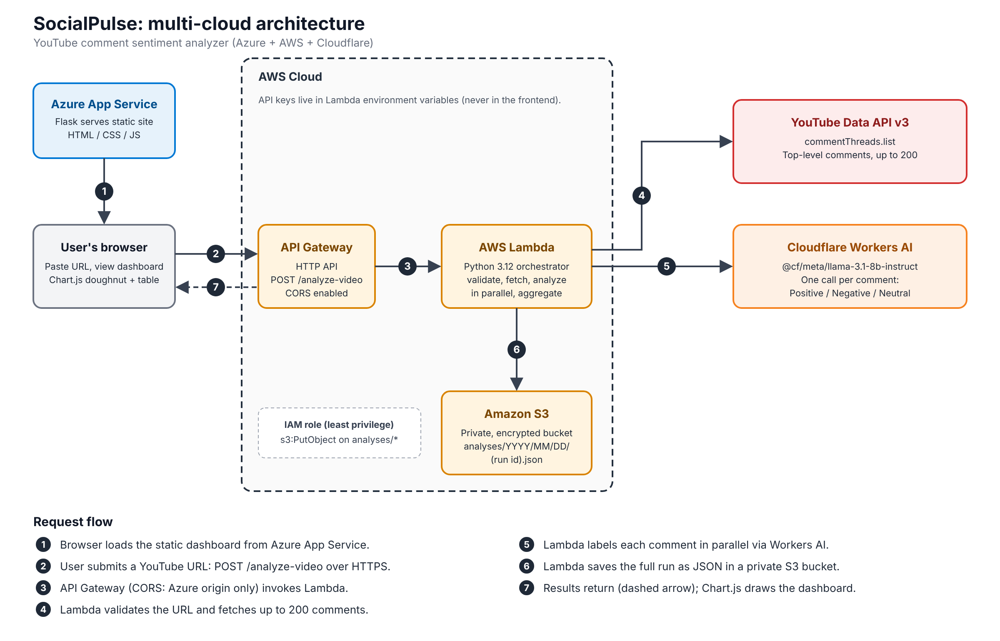

# SocialPulse — Multi-Cloud YouTube Comment Sentiment Analyzer

SocialPulse takes a YouTube video URL, retrieves its comments, classifies **each comment individually** as **Positive, Negative or Neutral**, stores the full result in a private cloud bucket, and shows the outcome on an interactive dashboard.

> Cloud Application Development — Semester V mini-project.

**Live demo:** `https://<your-app-name>.azurewebsites.net` *(replace with your Azure URL)*

---

## Architecture



```
User → Azure App Service (web UI)
     → AWS API Gateway (HTTP API)
     → AWS Lambda ──► YouTube Data API v3   (fetch comments)
                  ──► Cloudflare Workers AI (per-comment sentiment)
                  ──► AWS S3 (private)      (store result JSON)
     ← JSON result → dashboard
```

| Layer | Service | Role |
|---|---|---|
| Hosting | **Azure App Service** (Linux, Python 3.12, B1) | Serves the static dashboard (Flask + gunicorn). Holds no secrets and does no analysis. |
| API | **AWS API Gateway** (HTTP API) | Public endpoint `POST /analyze-video`, CORS limited to the Azure site, throttled (rate 5, burst 10). |
| Compute | **AWS Lambda** (Python 3.12) | Validates the URL, fetches comments, runs analysis in parallel, computes statistics, saves the result. |
| Storage | **AWS S3** (private, SSE-S3) | One JSON file per run: `analyses/YYYY/MM/DD/<run_id>.json`. |
| NLP | **Cloudflare Workers AI** (`@cf/meta/llama-3.1-8b-instruct`) | Classifies one comment at a time. |
| Data | **YouTube Data API v3** | `commentThreads.list` (top-level comments). |

The original plan used GCP Cloud Natural Language; Cloudflare Workers AI replaced it (the fallback named in the project brief).

## Features

- Paste any YouTube URL (`watch?v=`, `youtu.be`, `shorts`, `embed`, `live`).
- Up to **200** top-level comments per video, each classified individually.
- Dashboard: video thumbnail, overall mood verdict with net score (% positive − % negative), counts and percentages, doughnut chart, run details.
- Comment list with sentiment filters (with counts), text search with highlighting, and CSV / JSON export.
- Staged loading indicator with elapsed time.
- Dark/light theme (follows the system, with a manual toggle that is remembered).
- Results persisted to private S3 with the run ID shown in the UI.
- Clear error messages: invalid link, comments disabled, video not found, quota exceeded, server misconfiguration.

## Design decisions

- **Failed comments are never guessed.** If a comment cannot be classified, it is labelled `FAILED`, shown separately, and **excluded** from percentages (they are computed over successfully analyzed comments only, with a divide-by-zero guard). Defaulting to Neutral would silently distort results.
- **Model choice.** `distilbert-sst-2-int8` was tested first and rejected: it is binary (no Neutral) and overconfident — e.g. *"The video is 12 minutes long"* scored NEGATIVE at 0.993. An instruct LLM prompted to answer with a single word gives a proper three-way label.
- **Prompt-injection hardening.** Each comment is wrapped in `<comment>` tags, the system prompt instructs the model to treat it as data, and any `</comment>` in the text is stripped.
- **Time budget.** Lambda stops starting new work after 24 s (`BUDGET_SECONDS`) to stay under API Gateway's ~29–30 s integration limit; remaining comments are marked `FAILED (TIMEOUT)` rather than losing the whole run.
- **No database.** One run = one self-contained JSON document with no relational queries, so S3 is sufficient.

## Security

- API keys (YouTube, Cloudflare) exist **only** as Lambda environment variables, or a local git-ignored `.env`. The frontend contains no secrets; `config.js` holds only the public API URL.
- Lambda uses an **execution role** — no IAM user and no access keys. Its S3 permission is least-privilege: `s3:PutObject` on `analyses/*` of the one bucket.
- S3 bucket: Block all public access ON, SSE-S3 encryption.
- CORS restricted to the Azure origin; API Gateway throttling enabled because the API has no authentication.
- Comment text is rendered with `textContent` (no HTML injection / XSS).
- Azure host sets `X-Content-Type-Options: nosniff`.

## Repository layout

```
backend/
  lambda_function.py     Lambda handler: validation, orchestration, statistics
  youtube_client.py      URL parsing + YouTube Data API calls, error mapping
  sentiment_provider.py  Cloudflare Workers AI client (retries, backoff, deadline)
  storage.py             Save results to S3 or local folder
  local_server.py        Flask server for local development
  tests/test_basic.py    Offline unit tests
  requirements.txt
frontend/                Static dashboard (HTML, CSS, JS, Chart.js via CDN)
azure-site/              Flask static host + copy of frontend/ in static/
docs/                    Architecture diagram (svg, png)
.env.example             Template for local configuration
```

## API

`POST /analyze-video`

Request:
```json
{ "url": "https://www.youtube.com/watch?v=VIDEO_ID", "max_comments": 200 }
```

Success (200):
```json
{
  "run_id": "20261013T023006Z-932701f4",
  "created_at": "...",
  "video": { "url": "...", "video_id": "..." },
  "settings": { "provider": "...", "model": "...", "max_comments": 200 },
  "summary": {
    "retrieved": 200, "analyzed": 200, "failed": 0,
    "counts": { "positive": 0, "negative": 0, "neutral": 0 },
    "percentages": { "positive": 0.0, "negative": 0.0, "neutral": 0.0 }
  },
  "comments": [ { "text": "...", "sentiment": "POSITIVE", "status": "OK" } ],
  "storage": { "saved": true, "mode": "s3", "location": "analyses/2026/10/13/<run_id>.json" }
}
```

Errors return `{ "error": { "code": "...", "message": "..." } }`, e.g. `INVALID_URL`, `COMMENTS_DISABLED` (422), `VIDEO_NOT_FOUND` (404), `QUOTA_EXCEEDED` (429), `SERVER_CONFIG` (502).

## Run locally

Requirements: Python 3.12, a YouTube Data API key, a Cloudflare account ID and Workers AI token.

```bash
cd backend
pip install -r requirements.txt
cp .env.example .env        # Windows: copy .env.example .env
# edit .env and fill in YOUTUBE_API_KEY, CF_ACCOUNT_ID, CF_API_TOKEN
python local_server.py      # open the printed http://127.0.0.1:... URL
```

With `STORAGE_MODE=local` (default) results are written to `backend/local_results/`. For the local server, set `frontend/config.js` to `"/analyze-video"`.

Run the tests (offline, no keys needed):
```bash
cd backend
python -m unittest discover -s tests -v
```

## Deploy

**1. AWS S3** — create a private bucket (Block all public access, SSE-S3).

**2. AWS Lambda** — Python 3.12, 512 MB, timeout ≥ 30 s. Zip these four files at the zip root: `lambda_function.py`, `sentiment_provider.py`, `storage.py`, `youtube_client.py` (boto3 is included in the runtime). Environment variables:

| Variable | Value |
|---|---|
| `YOUTUBE_API_KEY` | YouTube key restricted to YouTube Data API v3 |
| `CF_ACCOUNT_ID`, `CF_API_TOKEN` | Cloudflare Workers AI credentials |
| `CF_MODEL` | `@cf/meta/llama-3.1-8b-instruct` |
| `STORAGE_MODE` | `s3` |
| `BUCKET_NAME` | your bucket |
| `ALLOWED_ORIGIN` | your Azure site origin |

Attach an inline policy allowing `s3:PutObject` on `arn:aws:s3:::<bucket>/analyses/*` to the Lambda execution role.

**3. API Gateway** — HTTP API with route `POST /analyze-video` integrated with the Lambda; enable CORS for the Azure origin; set stage throttling (rate 5, burst 10).

**4. Frontend** — put the API Gateway URL in `frontend/config.js`, copy `frontend/*` to `azure-site/static/`, zip `azure-site/`, and deploy:

```bash
az webapp deploy --resource-group <rg> --name <app> --src-path site.zip --type zip
```

Startup command: `gunicorn --bind=0.0.0.0 app:app`.

## Measured results

| Metric | Result |
|---|---|
| 200 comments, end-to-end | ~16.7 s |
| Lambda duration (CloudWatch) | ~10.2 s |
| Lambda max memory | 103 MB of 512 MB |
| Failed comments (typical run) | 0 |

## Testing

- **Unit tests (7, offline):** URL parsing, label parsing, failures not counted as Neutral, comments disabled, bad input and 200-comment cap, zero-analyzed percentage guard.
- **Failure scenarios tested manually:** invalid link, non-YouTube link, video with comments disabled, non-existent video, empty input.
- **Integration:** Azure site → API Gateway → Lambda → S3 verified, including from a phone on mobile data.

## Limitations

- Only top-level comments (no replies), max 200 per run.
- LLM classification can misjudge sarcasm, slang and mixed-language comments.
- YouTube API daily quota applies.
- The API has no user authentication; abuse is limited by throttling and the 200-comment cap.
- Timestamps and S3 date folders use UTC (may differ from IST by a day near midnight).

## Future improvements

- Authentication (e.g. API keys / Cognito) on the API.
- DynamoDB index of runs plus a history page.
- Reply threads, pagination beyond 200 comments, background processing for large videos.
- Fine-tuned or multilingual sentiment model; confidence scores.

## Author

Hardik Sonar — Cloud Application Development, Semester V.
